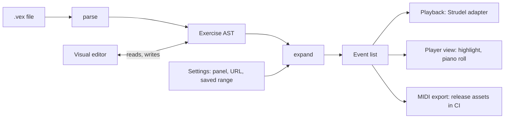

# Vocal exercises site — plan

Nov 26, 2026 · Marco

## Overview

A static site where singers pick a vocal exercise, set their range and tempo, and sing along to a generated piano accompaniment. Every exercise is a small text file, like a ChordPro song in the songbooks repo, and it compiles to Strudel for playback.

Two goals drive every decision:

- **Easy authoring.** Non-technical users build exercises in a visual grid; technical users type the text format. Both edit the same file.
- **Configurable runs.** The same exercise runs from any start note to any end note, at any tempo, in any listed scale, without a second file.

Audiences:

| Who                  | Needs                                | Touches                   |
| -------------------- | ------------------------------------ | ------------------------- |
| Singer               | Pick, configure, sing along          | Player only               |
| Teacher / choir lead | Create and share exercises           | Visual editor, share link |
| Contributor          | Add exercises to the default library | `.vex` files via PR       |
| Maintainer (Marco)   | Format, engine, CI                   | Everything                |

Non-goals: pitch detection and scoring, recording. The site is static on GitHub Pages; until optional accounts arrive in M5 (see Accounts), user-made exercises live in share links and the browser.

## Exercise format

An exercise is a `.vex` text file: ChordPro-style `{directives}` for metadata and settings, then one or more pattern lines written in scale degrees. Degrees are relative to the current root, so one pattern runs in every key the player steps through.

```text
{title: Major arpeggio}
{description: Warm up the middle voice on an open vowel}
{focus: warm-up, range}
{technique: legato}
{level: beginner}

{defaults: start=C3 end=G4 tempo=100 step=+1 direction=up-down}
{param: scale = major | minor}
{vowel: ah}

{cue: [I:2]}
[I] 1 3 5 3 | 1:2 r:2
```

### Pattern vs settings

The file holds two layers. The **pattern** (body lines, `cue`, `param`) is what the exercise is. The **settings** are how a run goes, and they are the same for every exercise, so the player shows one fixed control panel. `{defaults}` only seeds that panel.

| Setting        | Meaning                             | Example                            |
| -------------- | ----------------------------------- | ---------------------------------- |
| `start`, `end` | Lowest and highest root of the run  | `C3`, `G4`                         |
| `voice`        | Preset that fills `start` and `end` | `soprano`, `tenor`                 |
| `tempo`        | Beats per minute                    | `100`                              |
| `step`         | Semitones between repetitions       | `+1`, `+2`                         |
| `direction`    | Order of roots                      | `up`, `down`, `up-down`, `down-up` |
| `cue`          | Play the cue before each repetition | on / off                           |
| `count-in`     | Clicks before the first cue         | `1 bar`                            |

Values resolve in this order, later wins: exercise `{defaults}`, the singer's saved range, URL parameters, the control panel.

### Pattern syntax

| Token           | Meaning                                                                    |
| --------------- | -------------------------------------------------------------------------- |
| `1` … `7`       | Scale degree in the current scale                                          |
| `8`, `9`, `10`  | Degrees above the octave                                                   |
| `b3`, `#4`      | Chromatic alteration of a degree                                           |
| `5,` / `5'`     | Same degree an octave below / above                                        |
| `:2`, `:1/2`    | Duration in beats (default 1)                                              |
| `r`             | Rest                                                                       |
| `1~5`           | Glide (siren) from one degree to another                                   |
| `1/ma`          | Syllable shown and spoken for that note                                    |
| `[I]`, `[V7:2]` | Accompaniment chord as a Roman numeral, held until the next chord or `[-]` |
| `\|`            | Bar line, optional, checked against `{meter}`                              |

### Parameters

Each `{param: name = …}` becomes a control in the panel, with no code. A list of values renders as a dropdown, a range as a slider:

```text
{param: scale = major | minor | harmonic-minor | dorian}
{param: vowel = ah | eh | ee | oh | oo}
{param: speed = 1..3}
```

Pattern lines can switch on a parameter: `{if speed=3} 1 2 3 4 5 4 3 2 1:2 {else} 1 3 5 3 1:2 {end}`. This one construct is the limit for v1; anything more complex is written in raw Strudel (see Engine).

### More examples

```text
{title: Five-note scale}
{defaults: start=A2 end=E4 tempo=120 direction=up-down}
{cue: [I:1]}
[I] 1/ma 2/me 3/mi 4/mo 5/mu 4 3 2 | 1:2 r:2
```

```text
{title: Siren}
{defaults: start=C3 end=C4 tempo=60 step=+2}
{vowel: ng}
{cue: [I:2]}
[I] 1~8:4 8~1:4 | r:4
```

```text
{title: Octave jump}
{defaults: start=C3 end=F4 tempo=90}
{cue: [I:2]}
[I] 1:1/2 8:1/2 5 3 | 1:2 r:2
```

## Engine

The engine turns text into sound in two pure steps, `parse` then `expand`, and only the last adapter knows about Strudel. That keeps the engine testable in Node and makes Strudel swappable for Tone.js if its cycle-based model ever gets in the way.



The visual editor works on the AST, not the text, so the grid and text views can never drift apart. Settings join at `expand`, which is why one exercise runs in any range.

### Steps

1. **Parse.** A hand-written tokenizer and recursive-descent parser turn `.vex` into an Exercise AST. Every error carries line and column; the same code runs in the editor and in `vex lint`.
1. **Expand.** Given the AST and resolved settings, compute the list of roots (`start` to `end` by `step`, in the chosen `direction`), then emit events per repetition: count-in clicks, the cue chord, the pattern notes with degrees resolved to MIDI through the chosen scale, and the rest. Roots whose highest note would pass `end` plus the pattern's span are dropped, so a singer is never pushed past their top note.
1. **Adapt.** The Strudel adapter converts events to a Strudel pattern with `note()` values and explicit timings, played on the self-hosted piano samples. A thin interface (`play`, `stop`, `onEvent`) hides Strudel from the UI.

### Why Strudel fits, and where it doesn't

Strudel gives a reliable Web Audio scheduler, samplers and effects, and its REPL makes a good power-user mode: the player can show the generated Strudel code for anyone who wants to tweak it. Its mini-notation is built for loops, though, so range-walking logic lives in `expand`, not in Strudel. Strudel is AGPL-3.0, so the repo uses the same license.

### Security

Raw Strudel is JavaScript and gets evaluated. It is therefore never accepted from share links or imported files: those carry only `.vex`, which the parser turns into data. If raw Strudel blocks are kept at all, they are allowed only in library files reviewed by PR (see open questions).

## User experience

Five screens, all client-side. A singer reaches sound in two taps: pick an exercise, press play.

| Screen         | What it does                                                                                                       |
| -------------- | ------------------------------------------------------------------------------------------------------------------ |
| Library (home) | A row of collections, then exercise tiles; facet filters, favourites and search                                    |
| Player         | Play/stop, current root, notes highlighted as they sound, settings panel; plays one exercise or a whole collection |
| Editor         | Grid and text views of one exercise, live preview, share and export                                                |
| My range       | One-time setup of lowest and highest comfortable note; fills `start`/`end` everywhere                              |
| My exercises   | Favourites, my exercises and my collections on this device, with backup and restore                                |

### Player

- The settings panel sits beside the player on desktop and in a bottom sheet on mobile. Start, end, tempo, step, direction, cue and count-in are always there; `{param}` controls appear under them.
- The current root shows large, with its neighbours dimmed, so the singer sees where the run is heading.
- Note labels toggle between degrees (1 3 5), solfège (DO MI SOL, matching the songbooks' Italian names), and letter names (C E G).
- Keyboard: space plays/stops, arrows nudge tempo and range. The screen stays awake while playing (Wake Lock API).

### Visual editor

- A grid with scale degrees as rows (1 to 8, chromatic rows on demand) and beats as columns. Tap a cell to place a note, drag its edge to lengthen, long-press to add a syllable or glide.
- A chord lane above the grid takes Roman numerals from a menu; a cue lane sets what plays between repetitions.
- A text tab shows the same exercise as `.vex`. Both views edit one parsed model, so switching never loses anything; text the grid can't draw (an `{if}` block) shows as a locked lane.
- Errors show inline under the text (line, column, message), the same messages the CI linter prints.

### Sharing and uploaded data

No backend is needed for user content:

- **Share link.** The `.vex` text is compressed into the URL hash (`#x=…`), so it never reaches a server log. Settings can ride along as `&tempo=90&start=A2`.
- **Device storage.** My exercises and My range live in `localStorage`, with export and import as `.vex` files.
- **Submit to library.** A button opens a prefilled GitHub issue form with the exercise attached, the same pattern as the songbooks issue templates. A maintainer turns it into a PR.

### Languages

English and Italian from day one, with all UI text in i18n files as in the songbooks site. Exercise titles and descriptions can carry translations: `{title.it: Arpeggio maggiore}`.

- **Strings.** All UI text lives in `site/i18n/en.toml` and `site/i18n/it.toml`. The build turns the same keys into a JSON bundle for the player and editor scripts, so pages and scripts never disagree.
- **URLs.** Each language has its own path (`/en/…`, `/it/…`), as in songbooks, and the language switcher keeps you on the same page.
- **First visit.** The browser's language picks English or Italian; the choice is then stored on the device, and in the account when signed in.
- **Content.** Exercises and collections carry `title.it` and `description.it`, and facet labels come from `facets.yaml`. A missing translation falls back to English, and CI warns about it without failing the build.
- **Note names follow the language.** Italian shows solfège and Italian note names (DO RE MI) by default, English shows letter names; the label toggle in the player overrides either.
- **Sign-in in both languages.** Cognito's managed login pages and the sign-in emails are localised (see Accounts).
- **More languages later.** Adding one means a new `.toml` file plus facet labels; CI checks that every key exists in every language.

### Appearance

- A three-way **Light / Dark / System** control sits in the masthead next to the Theme dropdown, and in the settings sheet on phones.
- **System** is the default: it follows `prefers-color-scheme` and switches live when the operating system does.
- The resolved mode is written to `data-theme` (`light` or `dark`) by an inline script in `<head>` before first paint, so there is no flash. The choice is stored on the device, and in the account when signed in.
- Every theme defines a light and a dark token set (see Themes), and the contrast check covers both.

## Facets, collections and favourites

Exercises are described by several independent facets instead of one category, grouped into ordered collections (from the library or made by users), and marked as favourites per device. All of it stays static: library data ships with the site, user data lives in the browser.

### Facets

Some facets are written by the author and checked against a fixed vocabulary; others are computed by the engine from the pattern, so they can never be wrong.

| Facet         | Values                                                                         | Source                                              |
| ------------- | ------------------------------------------------------------------------------ | --------------------------------------------------- |
| Focus         | warm-up, range, agility, intervals, breath, resonance, cool-down (one or more) | Author, `{focus: range, agility}`                   |
| Level         | beginner, intermediate, advanced                                               | Author, `{level: …}`                                |
| Technique     | lip trill, hum, siren, staccato, legato, vowel shaping, glottal onset          | Author, `{technique: …}`                            |
| Voice         | any, or soprano, mezzo, alto, tenor, baritone, bass                            | Author, `{voice: …}`, default any                   |
| Span          | within a 3rd, a 5th, an octave, beyond an octave                               | Computed from the highest and lowest degree         |
| Length        | under 2 min, 2–5 min, over 5 min                                               | Computed at default settings                        |
| Fits my range | yes / no                                                                       | Computed from span against the singer's saved range |

The vocabulary lives in `site/data/facets.yaml` with English and Italian labels; `vex lint` rejects any value not listed there. The first `focus` value decides the exercise's folder and its colour, so the songbooks-style category accents still apply.

The Library filter bar shows one chip group per facet, with a count on each chip. Chips combine as OR within a facet and AND across facets, so "range" + "agility" + "beginner" means (range or agility) and beginner. Active filters are written to the URL (`#focus=range&level=beginner`), so a filtered view can be bookmarked or shared.

### Collections

A collection is an ordered list of exercises played back to back, optionally with settings per item, such as a slower tempo or a shorter run.

```yaml
# collections/daily-warm-up.yaml
title: 10-minute daily warm-up
title.it: Riscaldamento quotidiano, 10 minuti
description: Body to head voice in six short exercises.
level: beginner
items:
  - warm-up/lip-trill
  - warm-up/siren
  - id: range/major-arpeggio
    tempo: 90
    direction: up
  - agility/five-note-scale
  - pause: 20s
  - breath/long-tone
```

- **Library collections** live in `collections/` in the repo, reviewed by PR like exercises. CI checks that every id exists and computes the total length.
- **User collections** are built from an "Add to collection" button on every tile and in the player, and edited in a list where items can be reordered, removed or given settings. They are stored on the device, can be shared as a link (ids plus settings, and the full `.vex` text of any custom exercise in them), and can be submitted to the library through the same issue form as exercises.
- **The collection player** queues the items, shows progress ("3 of 6") and the time left, auto-advances after a short count-in, and lets the singer skip or repeat an item. Global settings such as the singer's range still apply unless an item overrides them.
- On the home page, collections appear as their own row of tiles above the exercises; a collection's cover stacks the contours of its first three exercises.

### Favourites

- A star on every tile, in the player and on collection items toggles a favourite.
- Favourites appear as a "Favourites" chip in the filter bar and as a built-in collection that plays them in the order they were starred.
- They are stored on the device with My exercises, My collections and My range. One "Back up my data" export produces a single JSON file, and importing it restores everything on another device.
- Signed-in users get automatic sync across devices (see Accounts); without an account, the backup file moves data between devices.

## Accounts

Accounts are optional and arrive in M5, built on AWS in an EU region and managed with OpenTofu; no third-party SaaS. Anyone can still create without signing in; an account adds sync across devices, a profile and one-click publishing. The site itself stays static on GitHub Pages and calls the API with `fetch`.

### What an account unlocks

| Feature                               | Without an account                          | With an account                       |
| ------------------------------------- | ------------------------------------------- | ------------------------------------- |
| Create exercises and collections      | Yes, stored on the device                   | Yes, synced                           |
| Favourites, My range, theme, language | This device only                            | Synced across devices                 |
| Share by link                         | Yes                                         | Yes                                   |
| Publish to the library                | GitHub issue form, reviewed by a maintainer | Community gallery, under your profile |
| Profile page                          | No                                          | Display name and published items      |

On first sign-in, everything already on the device uploads automatically, in the same JSON format as the backup file. After that, each item syncs on its own, and the most recently changed copy wins.

### Architecture

| Part       | AWS service                                                    | Role                                                                                                                                              |
| ---------- | -------------------------------------------------------------- | ------------------------------------------------------------------------------------------------------------------------------------------------- |
| Sign-in    | Cognito user pool, Essentials tier                             | Email one-time code or passkey, no passwords; managed login pages in English and Italian; issues JWTs                                             |
| API        | API Gateway HTTP API with a JWT authorizer                     | `GET`/`PUT /me/library`, `DELETE /me`, `GET /gallery`, `POST /gallery`, `POST /gallery/{id}/report`; CORS limited to the site's origin; throttled |
| Logic      | Lambda, TypeScript                                             | Validates every `.vex` with the shared engine parser before storing it, so the API never accepts a file the site can't play                       |
| Data       | DynamoDB, one table, provisioned capacity inside the free tier | Users, library items, published items and reports                                                                                                 |
| Email      | SES with a verified domain                                     | Sign-in codes, in the user's language                                                                                                             |
| Cost guard | AWS Budgets, API throttling                                    | Alert at $5 a month                                                                                                                               |

The region is Frankfurt or Milan, whichever offers every service above; both keep data in the EU.

Data model additions:

| Object         | Fields                                                                                           |
| -------------- | ------------------------------------------------------------------------------------------------ |
| User           | Cognito id, display name, language, created                                                      |
| Library item   | user, item id, kind (exercise, collection, favourites, settings), body, updated                  |
| Published item | id, author, `.vex` or collection body, facets, status (visible, hidden), report count, published |

### Deployment

- `infra/` holds the OpenTofu code and `api/` the Lambda handlers, in the same repository as the site.
- State lives in an S3 bucket with OpenTofu's native lock file. GitHub Actions authenticate through an OIDC role, so no AWS keys are stored in the repository.
- On a pull request touching `infra/` or `api/`, CI runs `tofu plan` and posts it as a comment. On `main`, `tofu apply` runs before the site release, so the site never calls an API version that doesn't exist yet.
- One production environment to start; a staging workspace can be added if changes start needing it.

### Privacy and moderation

- Only an email address and a display name are collected. There is no tracking or analytics.
- A privacy page in English and Italian explains what is stored and where.
- **Export** is the existing backup file. **Delete my account** removes the Cognito user and every item they own at once.
- Published items go live immediately. Anyone can report one; an item with reports is hidden until a maintainer reviews it.
- Moderation runs from a CLI command (`vex admin hide|restore`) instead of an admin interface in v1. Publishing is rate-limited per user.

### Cost

At this project's likely scale, accounts cost close to nothing, because every service in the plan has a free allowance that does not expire. Estimates assume about 300 API calls and 2 emails per active user per month, at US list prices; EU regions are roughly 10–20% higher.

| Active users per month | Cognito    | API Gateway | SES         | DynamoDB and Lambda | Total                                        |
| ---------------------- | ---------- | ----------- | ----------- | ------------------- | -------------------------------------------- |
| 100                    | $0         | about $0.03 | about $0.02 | $0                  | about $0, plus $0.50 for a custom API domain |
| 1,000                  | $0         | about $0.30 | about $0.20 | $0                  | about $0.50                                  |
| 10,000                 | $0         | about $3    | about $2    | $0                  | about $5                                     |
| 20,000                 | about $150 | about $6    | about $4    | $0                  | about $160                                   |

- Cognito Essentials includes 10,000 free monthly active users and charges $0.015 per user above that ([Cognito pricing](https://aws.amazon.com/cognito/pricing/)).
- DynamoDB's always-free tier covers 25 read and 25 write capacity units of provisioned capacity and 25 GB of storage; on-demand requests get no free allowance ([DynamoDB free-tier design](https://builder.aws.com/content/3KlSd7COLOAukLb2mPBFp3zN2dI/design-dynamodb-to-stay-in-the-always-free-tier)).
- Email verification before an account counts keeps bot sign-ups from using up the free users.

## Visual design

The site reuses the songbooks site design as is, and a Theme dropdown recolours it with six palettes, each with a light and a dark variant. gjed appears only in the footer.

### From songbooks, unchanged

- Typewriter type: Special Elite for display, Courier Prime for everything else, on a fixed px scale.
- A paper sheet on a desk, framed by a 1.5px ink border; radius 0 everywhere; hard offset shadows with 0 blur.
- The dark masthead band on the home page, square cover tiles, uppercase letter-spaced labels and chips.
- Light and dark variants through `data-theme`, with System following `prefers-color-scheme` (see Appearance).

### Personal touches

- **Staff lines.** The masthead band carries five faint staff lines. Exercises have no cover art, so each tile's cover is the melodic contour drawn on a five-line staff. In the player the notes sit on staff lines and the sounding note lifts with a hard shadow in the site colour.
- **Category accents.** Each category gets its own colour, like each songbook does, derived per theme with the songbooks OKLCH lightness clamp.
- **Footer credit.** "made by gjed" with the gjed mark (light or dark variant), linking to github.com/gjed. The mark appears nowhere else.

### Themes

Theme and mode are two separate choices: the dropdown picks the palette, the Light / Dark / System control picks the variant. Light values for each palette:

| Theme             | Desk      | Paper     | Ink       | Site colour | Band      | Band text / accent    | Character                        |
| ----------------- | --------- | --------- | --------- | ----------- | --------- | --------------------- | -------------------------------- |
| Manuscript        | `#e9e2d3` | `#faf6ee` | `#2a1f1a` | `#8c2f39`   | `#2b2320` | `#f3ece2` / `#f0a3a8` | Warm paper, oxblood              |
| Vermilion         | `#f4dcd0` | `#fff7f2` | `#2a1512` | `#c2321a`   | `#3b1410` | `#fde9df` / `#ff9b80` | Peach, vermilion, red-black band |
| Tangerine         | `#fbd9b8` | `#fff8ef` | `#2b1a10` | `#b84508`   | `#4a1f08` | `#fff1e2` / `#ffb26b` | Apricot, burnt orange, rust band |
| Tomato            | `#f7d4cb` | `#fffaf7` | `#2a1210` | `#b3261e`   | `#b3261e` | `#fff4ef` / `#ffd3a8` | Coral, with a red band           |
| Blood orange      | `#fde0cc` | `#fff5ec` | `#24110b` | `#a8320c`   | `#f97316` | `#1a0a04` / `#4a1205` | Bright orange band, dark type    |
| Songbooks classic | `#dde2ee` | `#f6f8fc` | `#1b2338` | `#0f7f8a`   | `#232c42` | `#eef1f7` / `#5fd0d8` | The original songbooks look      |

How it works:

1. **Themes are data.** `site/data/themes.yaml` holds one entry per theme with a light and a dark token set (desk, paper, card, ink, ink2, rule, site, site-ink, band, band-ink, band-ink2, band-accent) and optional category-accent overrides.
1. **Generated CSS.** Hugo renders them into `themes.css` as `:root[data-palette="vermilion"]` and `:root[data-palette="vermilion"][data-theme="dark"]` blocks. Components read only tokens, so a theme never touches component CSS.
1. **No flash.** An inline script in `<head>`, the songbooks theme-init pattern, applies the saved palette and mode from `localStorage` before first paint. With nothing saved, mode follows `prefers-color-scheme` and the palette falls back to the default theme.
1. **The dropdown.** A native `<select>` labelled "Theme" sits next to the Light / Dark / System control in the masthead, and in the settings sheet on phones. A native control keeps keyboard, screen reader and mobile pickers working for free. The choice is per device; share links never carry it, because a theme belongs to the viewer, not the exercise.
1. **Accent collisions.** Category accents are re-derived for each theme against its own surfaces. A theme overrides one that sits too close to its site colour, such as the orange warm-up accent in Tangerine and Blood orange, which switches to ochre.
1. **Checked in CI.** The contrast job runs over every theme and mode, failing below 4.5:1 for text and 3:1 for chrome, and flags any category accent too close to the theme's site colour.

Adding a theme is one YAML entry plus a passing contrast check, with no CSS. Manuscript's dark variant is already drawn (desk `#1a1512`, paper `#241d19`, ink `#f1e9de`, site `#f0a3a8`); the other dark variants are designed in M2.

## Repository layout and data model

One repo shaped like songbooks: content files in category folders, a Makefile as the entry point, Hugo for pages, generated site data, and a `skills/` folder for agents. The difference is one TypeScript engine shared by the browser and CI, so the linter and the player never disagree.

```text
exercises/
  warm-up/
    category.yaml            ← name, description, accent colour (like songbook.yaml)
    01-lip-trill.vex
    02-siren.vex
  range/
    category.yaml
    01-major-arpeggio.vex
engine/                      ← TypeScript package, no DOM dependencies
  src/parse.ts               ← .vex → Exercise AST, with line/column errors
  src/expand.ts              ← AST + settings → event list
  src/strudel.ts             ← event list → Strudel pattern
  src/contour.ts             ← AST → card contour line
  test/                      ← fixtures: .vex in, events JSON out
collections/                 ← library collections, one YAML file each
api/                         ← Lambda handlers (TypeScript, reuse engine/ to validate .vex)
infra/                       ← OpenTofu: Cognito, API Gateway, Lambda, DynamoDB, SES, Budgets
cli/vex.ts                   ← lint, build-data, new
site/
  hugo.toml
  layouts/  i18n/en.toml  i18n/it.toml
  data/themes.yaml           ← palettes, light and dark (see Themes)
  data/facets.yaml           ← facet vocabulary with en/it labels
  assets/css/main.css        ← component styles, tokens only
  assets/js/player.ts  editor.ts   ← bundled by Hugo's esbuild
skills/
  vex-exercise-authoring/SKILL.md
  atomic-conventional-commits/SKILL.md
.github/workflows/  pr-check.yml  release.yml
.github/ISSUE_TEMPLATE/  01-exercise-fix.yml  02-new-exercise.yml
Makefile  package.json  .releaserc.json  .renovaterc.json  AGENTS.md  CONTRIBUTING.md
```

The file prefix (`01-`) sets order within a category, as song numbers do in songbooks. The file path minus extension is the exercise id (`range/major-arpeggio`), used in URLs.

### Data model

| Object    | Fields                                                                                                                                         | Produced by                                   |
| --------- | ---------------------------------------------------------------------------------------------------------------------------------------------- | --------------------------------------------- |
| Exercise  | id, title (+ translations), description, facets (focus, level, technique, voice; span and length computed), defaults, params, cue, pattern AST | `parse`                                       |
| Settings  | start, end, tempo, step, direction, cue, count-in, param values                                                                                | Panel + resolution order                      |
| Event     | time (beats), duration, kind (note, chord, glide, click), midi or midi list, syllable, repetition index                                        | `expand`                                      |
| Site data | Exercise and collection lists with facets, contour, accent and length                                                                          | `vex build-data` → `site/data/exercises.json` |

The event list is the contract between engine and UI: playback, highlighting and the piano roll all read it, so a bug fix in `expand` fixes all three.

## CI/CD

Copy the songbooks pipeline: a PR check on content and engine changes, and one release workflow on `main` that runs semantic-release and deploys to GitHub Pages only when a release is cut. Conventional commits drive versions, so `feat(exercises): add siren` ships a minor release with the new exercise live.

### PR check (`pr-check.yml`)

| Job            | Runs when                                | Does                                                                                                                                                 |
| -------------- | ---------------------------------------- | ---------------------------------------------------------------------------------------------------------------------------------------------------- |
| Lint exercises | `exercises/**` changed                   | `vex lint` on changed exercises and collections, checking facet values and collection ids; errors become GitHub annotations at file, line and column |
| Engine tests   | `engine/**`, `cli/**` changed            | Vitest unit tests plus golden fixtures (`.vex` in, events JSON out)                                                                                  |
| Expand all     | Engine changed                           | Expands every library exercise at every voice preset, so an engine change can't break an existing exercise                                           |
| Site build     | Anything under `site/` or engine changed | `make site` with Hugo, no deploy                                                                                                                     |
| Contrast       | `main.css` or `themes.yaml` changed      | Checks every token pair in every theme and mode against 4.5:1 and 3:1 floors                                                                         |

Path filters and "build machinery changed, check everything" logic follow `pr-check.yml` in songbooks.

### Release (`release.yml`)

1. On push to `main`, check out with full history and set up Node.
1. Run `make all`: lint, test, build site data, render release assets.
1. Run semantic-release with `cycjimmy/semantic-release-action`, `tagFormat: v${version}`, branch `main`.
1. If a release was published: install Hugo (version pinned with a Renovate comment), build the site with the tag as the footer version, and upload the Pages artifact.
1. A separate `deploy-site` job with `pages: write` and `id-token: write` runs `actions/deploy-pages`.

Release assets, attached the way songbooks attaches PDFs:

- `exercises.zip`: all `.vex` files, for offline use or import.
- `midi/<id>-<voice>.mid`: each exercise rendered for each voice preset, for singers who practise in a DAW or another app.

Renovate keeps actions, Hugo, Strudel and npm packages current, using the same config preset as songbooks.

### Storage, and when S3 is needed

The whole site fits comfortably inside GitHub Pages' 1 GB limit:

- **Piano samples** (a few MB of a sampled piano) are self-hosted under `site/static/samples/` instead of loaded from Strudel's default GitHub sample URLs. This keeps playback working offline and avoids a runtime dependency on a third-party repo.
- **User exercises** live in share links and `localStorage`, as described in User experience.

Server-side storage arrives with accounts in M5, on AWS and managed with OpenTofu (see Accounts); the site itself stays on GitHub Pages.

## Default exercise library

Ship about 15 exercises at launch, covering every focus value, plus three library collections: 10-minute daily warm-up, Choir warm-up and Range builder. The Category column is each exercise's first focus value. Each one also serves as a test fixture, so together they must exercise every syntax feature at least once.

| Category  | Exercise        | Pattern                               | Features covered                    |
| --------- | --------------- | ------------------------------------- | ----------------------------------- |
| Warm-up   | Lip trill       | `1 2 3 4 5 4 3 2 1:2` on "brr"        | vowel                               |
| Warm-up   | Siren           | `1~8:4 8~1:4`                         | glide, step +2                      |
| Warm-up   | Hum to open     | `1:2 1/mm 1/ah:2`                     | syllables                           |
| Range     | Major arpeggio  | `1 3 5 3 1:2`                         | cue, scale param                    |
| Range     | Octave arpeggio | `1 3 5 8 5 3 1:2`                     | degrees above 7                     |
| Range     | Octave slide    | `1 8~1:3`                             | glide after leap                    |
| Agility   | Five-note scale | `1 2 3 4 5 4 3 2 1:2`                 | syllables, fast tempo               |
| Agility   | Nine-note scale | `1 2 3 4 5 6 7 8 9 8 7 6 5 4 3 2 1:2` | long patterns                       |
| Agility   | Rossini run     | sixteenth-note runs over 1.5 octaves  | `:1/4` durations, `{if speed}`      |
| Intervals | Thirds ladder   | `1 3 2 4 3 5 4 2 1:2`                 | stepwise logic                      |
| Intervals | Minor triad     | `1 b3 5 b3 1:2`                       | accidentals                         |
| Intervals | Chromatic step  | `1 #1 2 #1 1:2`                       | chromatic alterations               |
| Breath    | Long tone       | `1:8` on "ah"                         | very long notes, slow tempo         |
| Breath    | Staccato pulse  | `1:1/2 r:1/2` ×4, then `5:2`          | rests inside pattern                |
| Breath    | Messa di voce   | `1:8` with dynamic marking            | open: dynamics syntax (see Roadmap) |

Each file carries a one-line description of what to focus on. Teachers who contribute exercises get credit through `{author: …}`, listed on a credits page as in songbooks.

## Roadmap and open questions

Six milestones, each ending in a release a singer can use. The pipeline goes live in M1, so every later step ships through semantic-release.

1. **M0 Format and parser.** Write the `.vex` spec, `parse`, `vex lint` and golden fixtures. Gate: all 15 library files parse and lint clean.
1. **M1 Player.** Build `expand`, the Strudel adapter, the settings panel and Hugo library pages; set up both workflows. Gate: the first tagged release is live on GitHub Pages.
1. **M2 Design and range.** Apply the songbooks styles, the theme dropdown with all six themes and their dark variants, the Light / Dark / System control, contour covers, category accents, facet filters, favourites, the gjed footer, en/it i18n and My range. Gate: the contrast check passes for every theme in light and dark.
1. **M3 Editor and sharing.** Ship the grid and text editor, share links, device storage, collections (library and user-made) with the collection player, backup and restore, and the submit-to-library issue form. Gate: an exercise made in the grid round-trips through text and a share link unchanged.
1. **M4 Polish.** Add offline support (service worker), MIDI release assets and an accessibility pass on keyboard and screen reader use.
1. **M5 Accounts.** Ship the OpenTofu stack in `infra/`, the API, sign-in, sync of everything users save, the community gallery with reporting, and the privacy page. Gate: a user signs in on two devices and sees the same favourites and collections, and Delete my account leaves nothing behind.

Later: live pitch detection showing sung pitch against the target, and dynamics.

### Open questions

- [ ] **Name.** "Vocalizzi" (Italian for vocal exercises) fits the songbooks' Italian flavour; a neutral English name may reach further.
- [ ] **Dynamics syntax.** Messa di voce needs crescendo and diminuendo. Hairpins (`1:8<>`) or a velocity curve directive?
- [ ] **Accompaniment styles.** Block chords only, or also arpeggiated and drone, chosen per exercise or in the panel?
- [ ] **Tuning reference.** Offer A = 440 Hz only, or a setting for 442 Hz choirs and baroque 415 Hz?
- [ ] **Raw Strudel blocks.** Allow them only in library files reviewed by PR, or drop them entirely to keep exercises portable?
- [ ] **Default theme.** Which palette a first-time visitor sees: Manuscript, one of the orange/red themes, or Songbooks classic for continuity with the songbooks site.
- [ ] **Sign-in methods.** Email code and passkeys only, or also Google and Apple sign-in through Cognito? Social sign-in is easier for singers but adds provider setup and their terms.
